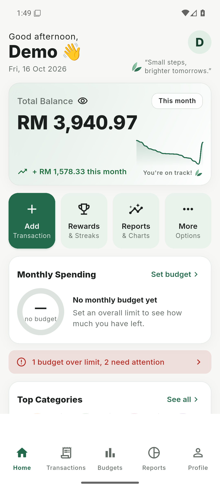
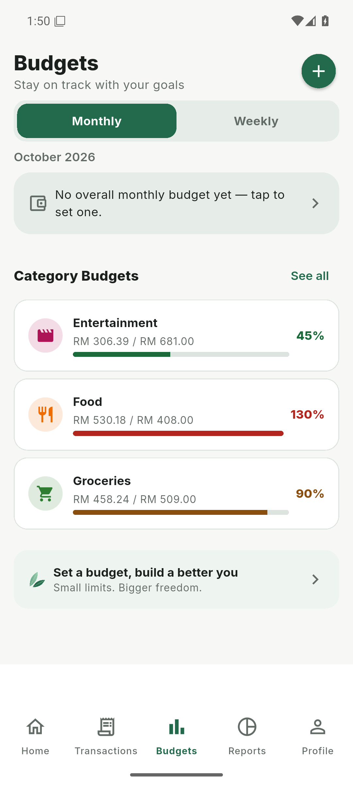
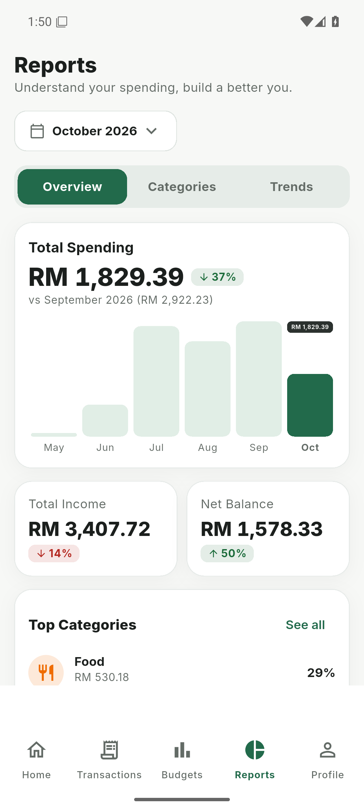
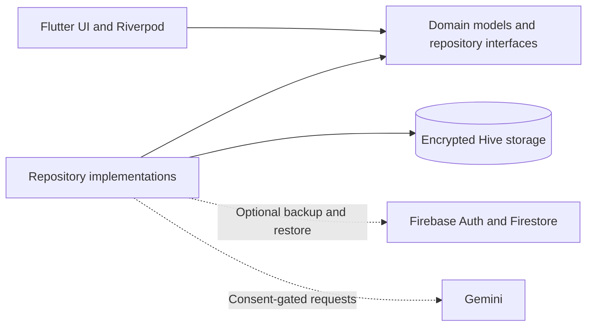

# Spendify

An offline-first Android budgeting app for students and young adults in Malaysia.

I built Spendify as my final-year capstone project to make everyday expense tracking easier to keep up with. It combines quick transaction entry, spending limits, reports, and optional AI receipt scanning in one app. The core budgeting workflow runs on local storage, so recording an expense does not depend on a network connection.

**Flutter · Riverpod · Hive · Firebase · Google Gemini**

[Screenshots](#screenshots) · [Run locally](#run-locally) · [Architecture](#architecture) · [Development guide](docs/DEVELOPMENT.md)

## Screenshots

| Home | Budgets | Reports |
| :---: | :---: | :---: |
|  |  |  |

Captured from the Android app using synthetic demo records. The amounts and dates illustrate the interface; they are not personal financial data. AI features are disabled in this preview. [Capture details](docs/images/README.md).

## Features

- **Transactions:** record income and expenses, choose a category and date, add a note, and edit or undo a deletion.
- **Budgets:** set weekly or monthly limits for a category or all spending, with clear approaching-limit and over-budget states.
- **Reports:** review weekly, monthly and yearly spending, category breakdowns, and trends from locally maintained aggregates.
- **Receipt scanning:** send a receipt photo to Gemini for extraction, then review and edit the fields before saving.
- **Spending insights:** generate advice from rounded category totals and trends, with optional follow-up questions.
- **Rewards:** earn XP, levels, coins and badges for budgeting actions and consistency.
- **Local control:** use encrypted storage, export data, control AI consent, and clear local records through settings.
- **Cloud backup:** optionally sign in with Firebase for Firestore backup and restore. Local reads and writes remain independent of sync.

Manual transactions, categories, budgets, reports and rewards work offline once a local session is available. Initial Firebase sign-in, cloud sync and fresh AI requests need connectivity. The sample-data build below provides a local demo session without Firebase.

## Run locally

Use Flutter **3.44.x** with Dart **3.12.2 or newer**, an Android SDK, and an emulator or device running **Android 7.0 / API 24+**. See the [development guide](docs/DEVELOPMENT.md) for Java and Android build setup.

```sh
git clone https://github.com/AzatKabulov/Spendify.git
cd Spendify
flutter pub get --enforce-lockfile
cp lib/firebase_options.example.dart lib/firebase_options.dart
flutter devices
flutter run -d <android-device-id> --dart-define=DEMO_SEED=true
```

On PowerShell, replace the copy command with:

```powershell
Copy-Item lib/firebase_options.example.dart lib/firebase_options.dart
```

Copy the example only if you do not already have a local Firebase configuration. It contains placeholder values that disable Firebase initialization. Keep your generated `firebase_options.dart` and `google-services.json` out of Git.

`DEMO_SEED=true` is a debug-only option for a fresh install. It adds sample transactions, budgets and rewards, and opens a local demo session. It does not overwrite existing transactions or run in a release build. A normal keyless launch reaches sign-in with authentication unavailable; it does not create a real account. Use a separate emulator for the preview rather than clearing your own data.

### Optional services

| Service | Setup |
| --- | --- |
| Firebase Authentication and Firestore backup | [Firebase setup](FIREBASE_SETUP.md) |
| Gemini receipt scanning, advice and follow-up questions | [AI setup](AI_SETUP.md) |
| Android release signing | [Release guide](docs/RELEASE.md) |

AI requires a configured key, network access and user consent. A key passed through `--dart-define` is included in the compiled app; it is not a server-side secret. The current client-key approach is a documented capstone limitation. See [security notes](docs/SECURITY_AUDIT.md) before distributing a configured build.

## Architecture

The app uses three layers: presentation, domain, and data. Business rules sit behind repository interfaces, with the domain independent of Hive, Firebase and Flutter UI code.



Three decisions shape the implementation:

- **Local data comes first.** Hive is the source of truth. Firestore is a backup/restore target, and the UI does not depend on Firestore streams.
- **Money uses integer minor units.** Values are stored in sen and formatted at the UI boundary.
- **Reports use cached aggregates.** Transaction changes maintain period totals so report views do not repeatedly scan the entire history.

For AI advice, the app sends aggregated, rounded spending summaries rather than raw transaction rows. Follow-up chat also sends the user's question and a bounded conversation history. Receipt scanning sends the image for extraction and requires confirmation before creating a transaction. [Architecture details](docs/ARCHITECTURE.md).

## Project structure

```text
lib/
  core/           Configuration, money utilities, theme, and demo seed
  domain/         Entities, repository interfaces, and pure business rules
  data/           Hive storage, remote clients, and repository implementations
  presentation/   Screens, shared widgets, and Riverpod providers
test/             Unit, widget, architecture, offline, and journey tests
integration_test/ Android performance checks
docs/             Design decisions, validation records, and release notes
```

## Checks

After completing the local setup:

```sh
flutter analyze
flutter test
flutter test test/dev/demo_seed_test.dart --dart-define=DEMO_SEED=true
```

See [development commands](docs/DEVELOPMENT.md) for coverage, performance tests and generated adapters. [Test results](docs/TEST_RESULTS.md) contain dated measurements and remaining checks; they are separate from the results of your own checkout.

## Status

Spendify is a pre-launch capstone project for Android. It currently uses a light theme and English interface. It has no bank connection, payment processing, iOS app or web client. Live-service behavior, physical-device checks and usability testing have their own [manual checklist](docs/MANUAL_TEST_CHECKLIST.md).

## Further reading

- [Development guide](docs/DEVELOPMENT.md) — setup, tests, builds and contribution workflow
- [Architecture](docs/ARCHITECTURE.md) — components, data flow and storage boundaries
- [Security review](docs/SECURITY_AUDIT.md) — controls and known limitations
- [Test results](docs/TEST_RESULTS.md) — recorded evidence and open validation
- [Release guide](docs/RELEASE.md) — signing and distribution checks
- [Demo script](docs/DEMO_SCRIPT.md) — walkthrough using sample data

For a bug or suggested improvement, include the screen, reproduction steps, app version and Android version. Use sample records and remove account details from screenshots.
